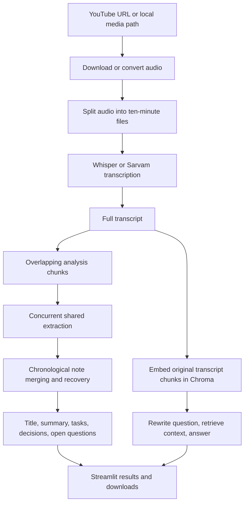

# AI Meeting Intelligence Assistant: technical documentation

Updated: 2026-10-17. Describes the current implementation in this repository.

## Summary

- Audio becomes a plain transcript through local Whisper or Sarvam's transcription/translation API.
- One shared analysis pass extracts summaries, tasks, decisions, and question/answer notes from overlapping transcript chunks, with up to three requests in flight.
- An LLM merges chronological notes into the final report; bounded recovery handles large requests and cut-off output, with a visible review notice when model reconciliation cannot finish.
- A shared provider factory supports Mistral, Gemini, Groq, OpenAI, Anthropic, and custom OpenAI-compatible endpoints through `.env`.
- Streamlit and the CLI provide conversational RAG over the original transcript; Streamlit also exports reports, individual results, JSON, and chat in a ZIP.

## Contents

- [Architecture and entry points](#architecture-and-entry-points)
- [Audio processing and transcription](#audio-processing-and-transcription)
- [Shared meeting analysis](#shared-meeting-analysis)
- [LLM configuration](#llm-configuration)
- [Conversational RAG](#conversational-rag)
- [Application state and downloads](#application-state-and-downloads)
- [Storage and external services](#storage-and-external-services)
- [Failures and current limits](#failures-and-current-limits)
- [Running and verification](#running-and-verification)

## Architecture and entry points

This is a Python application with a Streamlit interface and a separate CLI.
Audio conversion, Whisper inference, embeddings, and Chroma storage run on the
application host. Meeting analysis and chat use the selected external LLM
endpoint; Hinglish transcription also sends audio to Sarvam.



The entry points call the same underlying analysis implementation:

- [`app.py`](../app.py) runs audio processing, transcription, shared analysis,
  and RAG setup when the user selects **Analyse**. Results live in session state.
- [`main.py`](../main.py) exposes `run_pipeline(source, language="english")`,
  prints the resulting report, and starts an interactive chat when run directly.
- [`test.py`](../test.py) is a manual runner with a hardcoded example URL. It
  processes real media and can make real API calls; it is not a unit test suite.

Key modules:

```text
core/
  analysis.py        Shared chunk analysis, validation, merging, recovery
  llm.py             Provider selection and client construction
  summarizer.py      Title/summary compatibility helpers
  extractor.py       Extraction compatibility helpers
  transcriber.py     Whisper and Sarvam routing
  vector_store.py    Embeddings, Chroma persistence, retrieval
  rag_engine.py      History compaction, rewriting, grounded answering
utils/
  audio_processor.py Media acquisition, conversion, audio chunking
  exports.py         In-memory reports, JSON, and ZIP construction
```

The normal pipeline is sequential between stages. Concurrency is within the
shared transcript-analysis stage, not across transcription and indexing.

## Audio processing and transcription

[`utils/audio_processor.py`](../utils/audio_processor.py) routes strings starting
with `http://` or `https://` to `yt-dlp`. It requests the best available audio,
extracts WAV through FFmpeg, and writes under `downloades/` using the video title.
This URL branch does not apply the local-file normalization step afterward.

For a local file, `convert_to_wav()` uses pydub to produce a mono, 16 kHz WAV
beside the original file, with `_converted.wav` appended to its stem. Both
branches then use `chunk_audio()` to create fixed ten-minute WAV pieces.
These are time boundaries, not speaker or silence boundaries.

[`core/transcriber.py`](../core/transcriber.py) processes those pieces sequentially:

- `english` selects Whisper. `load_model()` lazily loads `WHISPER_MODEL`
  (default `small`) into the process-global `_model`. The call uses
  `model.transcribe(..., task="transcribe")`; it does not force a language code
  or request translation. Subsequent chunks reuse that loaded model.
- `hinglish` selects Sarvam's `speech-to-text-translate` endpoint. Each coarse
  audio chunk is split into 25-second files and submitted sequentially, with
  `SARVAM_STT_MODEL` defaulting to `saaras:v2.5`. Requests have a 120-second
  timeout, and diarization is disabled. Temporary Sarvam pieces are removed in
  a `finally` block.

`transcribe_all()` joins the returned text into one string. The downstream
analysis does not receive timestamps or speaker-label structures. The selected
engine applies to every audio chunk; there is no per-chunk engine selection.

## Shared meeting analysis

[`core/analysis.py`](../core/analysis.py) exposes:

```python
report = analyze_meeting(transcript)
```

The report contains five string fields: `title`, `summary`, `action_items`,
`key_decisions`, and `open_questions`. The app and CLI add the original
`transcript` and the runtime `rag_chain` to their result dictionaries.

### Chunking and extraction

The transcript is split with `RecursiveCharacterTextSplitter`. Defaults are
6,000 UTF-8 bytes per chunk and up to 300 bytes of overlap. The size function
counts bytes as a conservative offline token estimate. It is not a native
tokenizer, and character count, byte count, and provider token count differ.

Each chunk normally needs one LLM call that returns all analysis fields
together. The intermediate Pydantic schema is:

```json
{
  "title": "Release Planning",
  "summary": ["The team agreed to release on Friday."],
  "action_items": [
    {"task": "Test checkout", "owner": "Priya", "deadline": "Thursday"}
  ],
  "key_decisions": ["Release on Friday."],
  "questions": [
    {"question": "Who approves the release?", "answer": null}
  ]
}
```

Missing owners, deadlines, and answers use `null`; absent categories use empty
arrays. JSON is decoded strictly and validated against `MeetingNotes`,
`ActionItem`, and `Question`. Extra fields are rejected. This uses a prompted
JSON schema and local validation, rather than requiring every provider to
implement the same native structured-output API.

`ThreadPoolExecutor` permits up to three chunk requests at a time per analysis
run. `executor.map()` preserves transcript order when collecting results.
Progress callbacks execute on the calling thread, so workers do not update
Streamlit state. Analysis constructs one provider client for that run and uses
temperature `0.2`.

### Merging and questions answered later

The merge LLM receives extracted notes in chronological order, with their
portion ranges. It is prompted to deduplicate overlap, retain distinct tasks
and their owners/deadlines, reconcile decision changes, and generate a title
from the combined material. It does not reread the original transcript.

For example, an early chunk may contain an unanswered question about release
approval. A later chunk's summary or question/answer entries may identify the
approver. The merge prompt asks the model to connect those facts by meaning.
There is no separate question-ID matching system. If extraction omits the
answer, merging may miss it as well.

Answered questions and their answers remain in intermediate notes for later
merge levels. Final rendering includes only unanswered questions in
`open_questions`. Missing owners and deadlines are displayed as `Not specified`.
Videos with no meeting tasks or decisions use empty extraction arrays; there
is currently no separate summary-only mode.

Combined notes that exceed the input budget are grouped into adjacent batches
and merged over multiple levels. Singleton batches carry forward unchanged.
The ordinary path costs N chunk calls plus one merge call; long meetings and
recovery need more calls.

### Limits and recovery

The default analysis settings are:

```env
ANALYSIS_MAX_CONCURRENCY=3
ANALYSIS_CHUNK_BUDGET=6000
ANALYSIS_OVERLAP_BUDGET=300
ANALYSIS_INPUT_BUDGET=16000
```

The input check includes the transcript or notes, instructions, JSON schema,
and a small message-framing reserve. It uses the same conservative byte-based
estimate. Output length follows the selected provider/client's default. The
application does not pass `max_tokens`, `max_output_tokens`, or
`max_completion_tokens` and has no output-size environment setting. The client
may supply its own default; provider limits remain finite and may be below
the model's advertised maximum.

- Requests that exceed the local input budget split before submission.
- Recognized provider context-size errors also trigger smaller-source recovery.
- Length-limit finish metadata is checked even when the returned JSON is valid.
  Visibly incomplete JSON can indicate truncation when metadata is absent.
- A cut-off chunk is divided into smaller Unicode-safe source pieces, preferably
  at word boundaries, with at most four recovery split levels.
- Failing merges try smaller groups with at most three recovery subdivision
  levels. The normal batch-reduction loop has a separate limit of 12 levels.

If merging still cannot complete, `_combine_notes()` assembles previously
validated fields locally. It removes exact duplicates, preserves distinct
items, uses an existing title candidate, and adds a **Review needed** notice
at the start of the summary. Conflicting explicit answers remain visible,
and their question stays open. This fallback does not claim full semantic
matching or decision reconciliation; the notice also appears in exports.

If source extraction never produces complete valid notes, analysis raises an
error instead of publishing partial extraction. Other malformed extraction
also fails explicitly. Authentication failures, network failures, and quota
errors are not hidden by size recovery. Client
libraries may apply their own retry behavior.

Choose input budgets that fit the selected model's context window, allowing
room for its response. These analysis settings
do not limit RAG chat calls. Concurrency can be reduced to `1` for stricter quotas.

### Compatibility helpers

[`core/summarizer.py`](../core/summarizer.py) and
[`core/extractor.py`](../core/extractor.py) remain as wrappers. Passing one
shared `analysis=report` reuses its fields. Calling each wrapper separately
without that argument starts fresh analysis each time; the application entry
points avoid this by calling `analyze_meeting()` once.

## LLM configuration

[`core/llm.py`](../core/llm.py) centralizes `get_llm(temperature=0.3)`.
`LLM_PROVIDER` selects an integration, `LLM_MODEL` selects its model, and the
provider's key authenticates the request. Keys are not detected automatically.

- `mistral`: `ChatMistralAI`, using `MISTRAL_API_KEY`.
- `gemini`: `ChatGoogleGenerativeAI`, using `GOOGLE_API_KEY` and the Developer
  API (`vertexai=False`).
- `groq`: `ChatGroq`, using `GROQ_API_KEY`.
- `openai`: `ChatOpenAI`, using `OPENAI_API_KEY`.
- `anthropic`: `ChatAnthropic`, using `ANTHROPIC_API_KEY`.
- `openai_compatible`: `ChatOpenAI`, using `LLM_API_KEY` and `LLM_BASE_URL`.

Only the selected integration is imported. The factory validates missing or
placeholder keys and reports missing integration packages. It does not switch
providers silently. Mistral is the default, with `mistral-small-latest` when no
model is supplied; every other provider requires `LLM_MODEL` explicitly.
RAG uses the factory's default temperature `0.3`.

The entry points call `load_dotenv()` before importing processing modules.
Existing shell variables take precedence over `.env`. Restart the application
after changing settings, particularly transcription settings read at import
time. There is no provider dropdown in the app. See
[`.env.example`](../.env.example) for the full configuration template.

## Conversational RAG

### Indexing the original transcript

[`core/vector_store.py`](../core/vector_store.py) splits the original transcript
into 500-character chunks with 50-character overlap. Each `Document` stores a
`chunk_index`. `HuggingFaceEmbeddings` uses `all-MiniLM-L6-v2` on CPU, and Chroma
persists to `vector_db/` under collection `meeting_transcript`.

`build_rag_chain()` constructs the vector store and retrieves up to four chunks
with similarity search. The app and CLI use this build path for each analysis.
`load_vector_store()` and `load_rag_chain()` also exist, but those entry points
do not expose a saved-meeting reload workflow.

### Follow-up question flow

[`core/rag_engine.py`](../core/rag_engine.py) accepts:

```python
answer = ask_question(rag_chain, question, chat_history)
```

`ConversationalRAGChain` performs these steps:

1. Convert stored user/assistant dictionaries to message objects.
2. Keep the latest four messages. If older messages exist, summarize all older
   turns into at most four lines and place that summary before the recent turns.
3. Rewrite the new question into a standalone retrieval question, resolving
   references such as "it" or "that decision" using that compact history.
4. Retrieve four relevant chunks for the rewritten question.
5. Generate an answer from the rewritten question and retrieved context only.

Every question incurs rewriting and answer generation, even when already
standalone. More than four stored history messages adds a history-summary
call. That summary is recomputed from the older turns; it is not a persisted
rolling memory. Its output is limited to four lines, but its input still grows
with the stored conversation.

The final answer prompt excludes chat history and instructs the model to use
only retrieved context. If that context lacks the answer, it requests this
fallback: `I could not find this information in the meeting transcript.`
This is a prompt instruction, not independent factual verification. The app
does not display retrieved source chunks or citations alongside answers.

## Application state and downloads

The Streamlit session stores `result`, `chat_history`, `pipeline_done`, and
`pipeline_steps`; `processing` is also initialized. A new analysis clears the
previous result and chat. Results are assigned only after analysis and RAG
setup both succeed. On failure, the app displays the exception and resets
active steps to pending; it does not checkpoint a completed transcript for retry.
Ordinary UI reruns reuse session results instead of running analysis again.

Chat sends the previous history before appending the new user/assistant pair.
Clearing chat empties the history used for future rewrites. The CLI maintains
its own history list and exits chat on `exit`, `quit`, or `q`.

[`utils/exports.py`](../utils/exports.py) builds UTF-8 downloads in memory:

- `report.md` and `report.txt` contain the title and all result sections.
- Individual text files contain summaries, tasks, decisions, questions, and transcript.
- `results.json` includes whitelisted result fields and the current chat history.
- `chat.txt` is included when chat history is non-empty.
- `all_results.zip` bundles those files with fixed internal entry names.

The live RAG chain is never serialized. Download names use a sanitized,
length-limited meeting title. Download buttons use `on_click="ignore"`, so a
download does not restart processing. Subsequent UI reruns rebuild exports from
the latest chat. PDF generation is not implemented, even though PDF-related
packages are listed among dependencies.

## Storage and external services

- Downloaded audio and coarse audio chunks remain on disk. Local conversions
  and their chunks are written beside the supplied media file. Only Sarvam's
  short temporary pieces have automatic cleanup.
- Whisper weights and embedding assets may download on first use and remain
  cached. Whisper's loaded model is shared within a process.
- `vector_db/` persists transcript embeddings and chunks. The collection name
  is shared across runs; there is no per-meeting namespace or clearing step.
  Previous meeting content can therefore remain available to retrieval.
- Analysis and chat state are in memory; there is no application-level meeting
  database or automatic report archive. User downloads are the report-saving path.
- Network access can include YouTube, model downloads, the selected LLM service,
  Sarvam for Hinglish, and the Google Fonts import used by the app's CSS.
- CLI processing prints a transcript preview, and `ask_question()` prints chat
  questions and answers. Treat console logs as meeting content.

Keep `.env`, media, model tools, vector data, and personal prep documents out
of source control. The public technical document and implementation change
notes are tracked separately from `docs/prep/`.

## Failures and current limits

- There is no authentication layer, per-user storage isolation, or deployment
  design for concurrent untrusted users. Per-session UI state does not isolate
  the shared vector collection, process-global Whisper model, or environment keys.
- Transcription and Sarvam pieces remain sequential. Concurrency applies only
  to analysis chunks, and the limit is per analysis run rather than global.
- Fixed audio boundaries can split speech. No speaker diarization or timestamp
  references survive the plain-text transcription pipeline.
- JSON validation checks structure, not factual accuracy or extraction
  completeness. Cross-chunk answers depend on evidence surviving extraction
  and being matched correctly by the model.
- Grounding depends on retrieval quality. Shared collection reuse can mix
  meetings, and chat-history compaction can itself become large on long chats.
- Sarvam non-success responses raise HTTP errors after logging status/body;
  there is no application-level Sarvam backoff loop. The CLI propagates pipeline
  exceptions, while Streamlit displays them.
- A failed run has no persisted progress checkpoint. Downloaded audio may be
  reusable manually, but the app does not offer resume-from-transcript controls.

## Running and verification

Follow the [README setup instructions](../README.md#installation) to create
`.venv`, install `Requirements.txt`, install FFmpeg, and configure `.env`.
Copy `.env.example` only for a new setup; preserve existing credentials when
updating an installation. Configure a model supported by the selected account.

On Windows, from the repository root:

```powershell
powershell -ExecutionPolicy Bypass -File .\start.ps1
```

The script uses `.venv`, adds project-local FFmpeg under `.tools/ffmpeg` when
present, verifies FFmpeg is available, and starts Streamlit. Otherwise, with
the environment activated:

```bash
python -m streamlit run app.py
```

For the CLI:

```bash
python main.py
```

The current implementation passed 34 local mocked tests covering provider
configuration, analysis request counts, ordering, recovery, fallback reports,
exports, and Streamlit/CLI integration. Compilation and dependency checks also
passed. The local test suite is not distributed in this repository. These
checks do not establish live API compatibility, model accuracy, or measured
performance; end-to-end generation still needs valid credentials and model quota.

See the [implementation change notes](changes/) for the focused history of
provider support, shared analysis, conversational RAG, and downloads.
